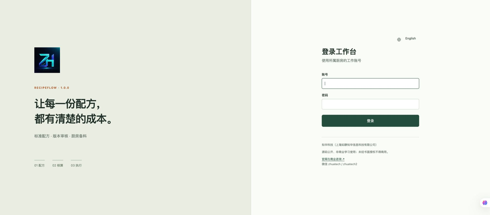
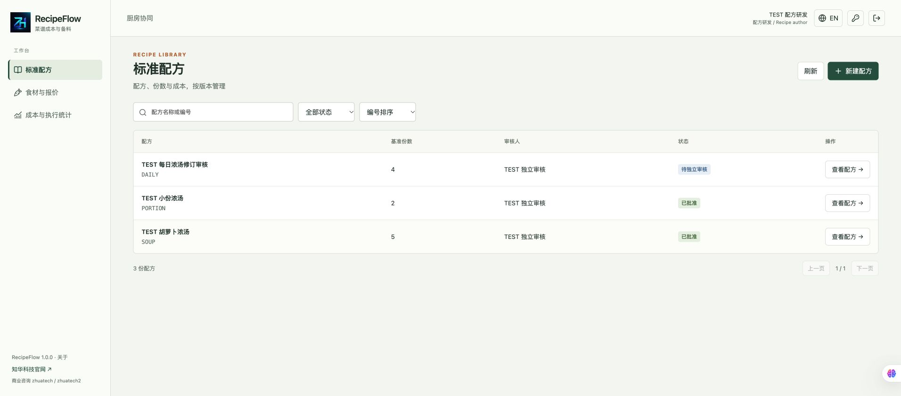
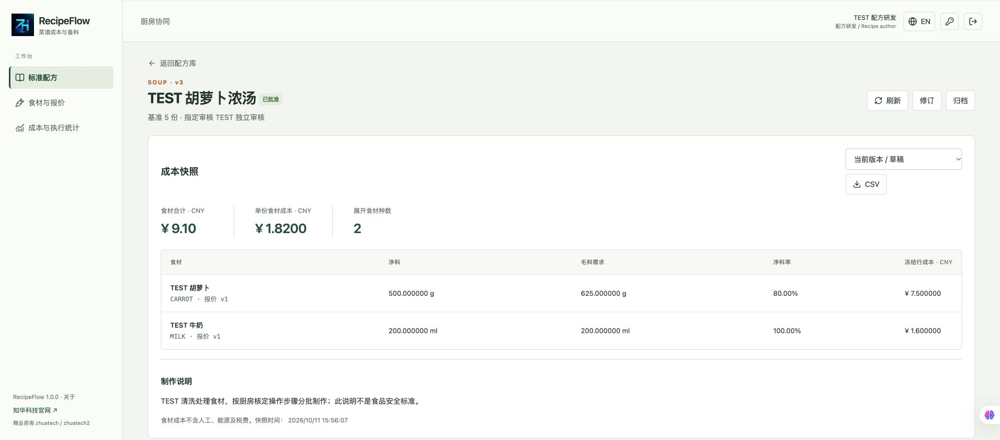
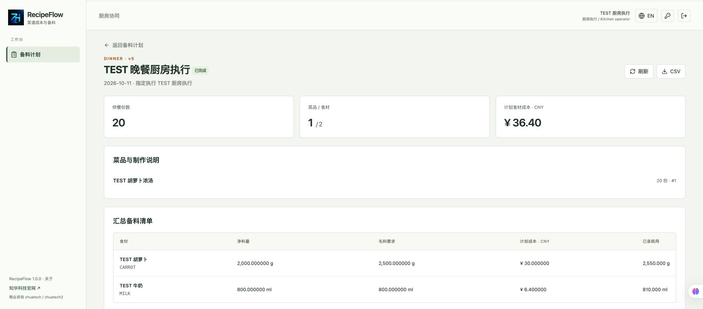
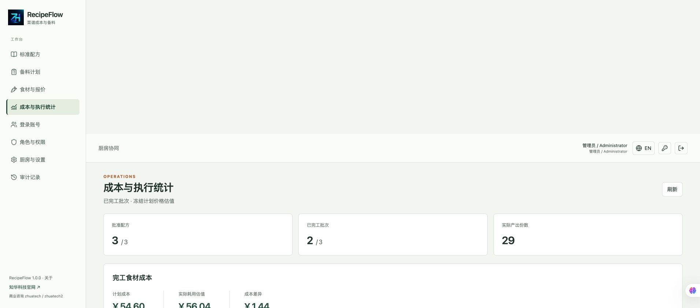
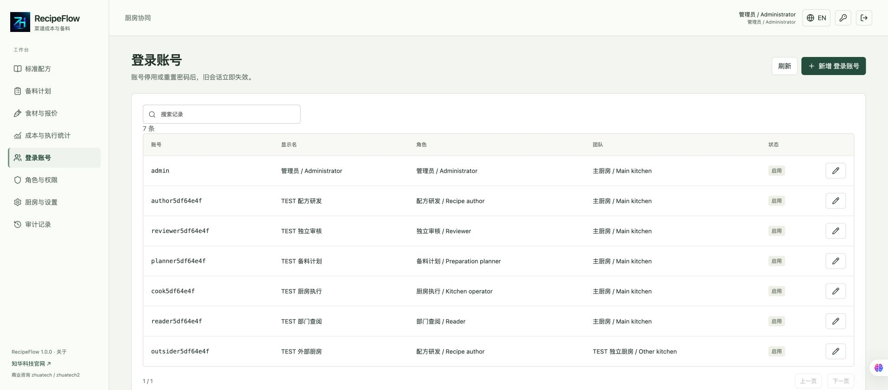
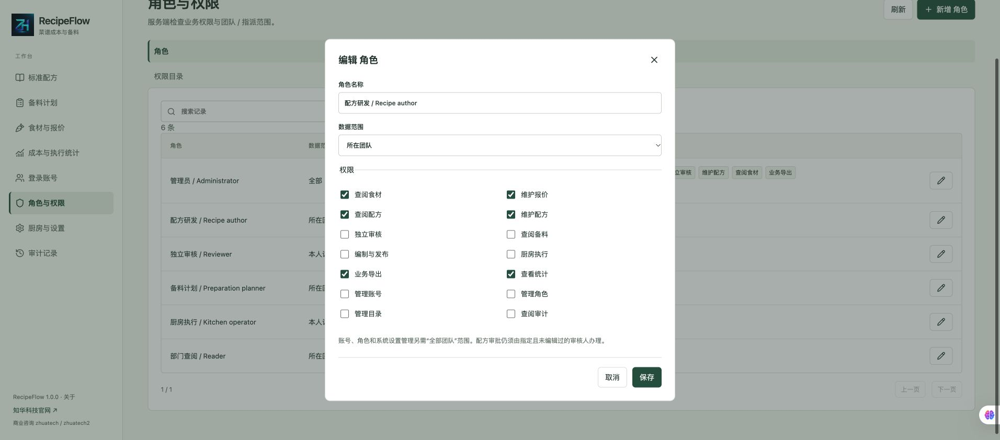

# RecipeFlow · Recipe Costing & Kitchen Preparation

[中文](README.md) | [English](README.en.md)


A **source available, non-commercial learning edition** by ZhiHua Technology (Shanghai Rujing Zhihua Information Technology Co., Ltd.). Java21, Spring Boot, Vue3 and MySQL8.4 connect standard recipes, ingredient quotes, independent review, preparation planning and actual kitchen consumption. Intended for personal learning and non-commercial evaluation of restaurant development kitchens, catering teams and central-kitchen workflows. [Official website](https://www.zhuatech.cn/). Written authorization is required for commercial use.

## From a recipe to a service batch

1. Maintain purchase quantities, units, total prices and usable yields.
2. Author a recipe using ingredients and pinned, approved component recipes.
3. An assigned independent reviewer approves a captured recipe and ingredient-cost snapshot.
4. Plan portions using approved recipes, consolidate requirements and assign an operator.
5. Enter actual raw consumption, included waste and output portions; complete the batch and inspect variances.

**Changing a quote never rewrites historical costs.** Current-quote comparison is a separate read-only calculation. Approved recipes require a new draft and another review for revision. Released plans continue using their captured versions.

## Implemented workspaces

| Workspace | Current capabilities |
| --- | --- |
| Recipe author | Ingredient categories and quotes, usable yields, ingredient/component lines, portion conversion, drafts and archiving, current-quote comparison, historical revisions and CSV |
| Reviewer | Assigned review queue, approval/return, historical-editor exclusion, quote-version checks, decision notes and history |
| Planner | Approved recipes, service dates and portions, consolidated ingredients, operator assignment, draft editing, release and cancellation before execution |
| Kitchen operator | Assigned plans, preparation instructions, start, atomic consumption/waste and output recording, notes, immutable completion and CSV |
| Administration | Accounts, BCrypt passwords, roles/permissions, kitchens and IANA zones, menu activation/order, ingredient categories, capacity settings, last-administrator protection and audit |
| Queries | Name/code search, state/category filters, sorting and pagination, recipe and completion statistics, consumption valued at captured planning prices |

Chinese/English UI and responsive kitchen pages are available. Reading does not grant writing: quote maintenance requires `quote`, recipe editing `design`, planning `plan`, and kitchen execution `execute`.

## Running pages

Screenshots show fictitious data in an isolated test kitchen, not customer case studies.















[Completion variances](docs/screenshots/10-completion.jpg) · [Component preparation](docs/screenshots/11-components.jpg) · [English UI](docs/screenshots/08-english.jpg) · [Mobile kitchen page](docs/screenshots/09-mobile.jpg)

## Calculation rules and limits

- One currency, CNY, and ingredients only. **Excludes labor, utilities, rent and taxes; this is not total profit.** Actual consumption is estimated using the plan's weighted raw-ingredient unit price, not actual purchase prices or inventory postings.
- kg/g represent mass, l/ml volume, and pc count. Only same-dimension conversions are allowed; density is never assumed. Ingredient codes, kitchens and measurement dimensions are immutable.
- Quantities have up to3 decimals, quotes4, usable yields2, ranging from0.01% to100%. Raw requirement equals usable quantity divided by yield. Decimal calculations use usable quantities at6 decimals, raw quantities rounded outward to6, unit costs12, line costs6, and final totals rounded to cents. [Exact rules](docs/architecture.md).
- Components pin approved recipe structure and portions. Submission refreshes all expanded ingredient quotes and yields. Up to40 lines,100 expanded ingredients and5 dependency levels and200 component preparation steps; cross-revision cycles are rejected. Preparation supports20 dishes,1–100000 portions per dish.
- Quote changes during review require return and resubmission. The assigned reviewer must never have edited the recipe. Administrators cannot act for assigned reviewers/operators.
- Released demand is immutable; running batches cannot be cancelled. Completion requires every consumption/output row. Zero consumption, waste and output variances require explanations. Waste is included in consumption, not charged twice.
- One company, multiple internal kitchens, a single low-volume instance. Writes serialize and check versions to reject concurrent overwrites; no high-throughput multi-tenant SaaS claim.
- **Not implemented:** POS synchronization, inventory, procurement, payments, nutrition calculation, allergen judgment, food-safety certification, automated recommendations or third-party integrations. No AI, external accounts, API keys or paid services are required.

## Architecture and repository

Browser → same-origin Nginx → Spring Security session/CSRF → transactional services/JPA → MySQL. Flyway manages migrations; Hibernate validates only. Every request checks current account, role and kitchen scope. Disabling an account/kitchen or resetting a password invalidates existing authentication.

```text
zhuatech-recipeflow/
├── backend/              Java21 / Spring Boot4.0.7 / Security / JPA
│   └── src/main/resources/db/migration/  V1 identity, V2 recipes/preparation
├── frontend/             Vue3.5.43 / Vite8.1.5 / bilingual workspaces
├── docs/                 Operations, calculations, API, security, deployment, screenshots
├── scripts/              Configuration, business checks, private backup/restore
├── compose.yaml          MySQL8.4 + backend + frontend
├── README.md
└── LICENSE               Custom non-commercial source license
```

Requirements: Docker Engine and Composev2. Local development also requires JDK21, Maven3.9+, Node.js24.19.0+ and npm. Images use Temurin21, Node24.19.0 and Nginx1.29. The frontend has no simulated-success mode disconnected from the backend.

## Install and run

```bash
python3 scripts/init-env.py
docker compose config --quiet
docker compose up --build -d --wait
```

Open **http://127.0.0.1:8133/**. Health: **http://127.0.0.1:8133/actuator/health**. `ADMIN_USERNAME` defaults to `admin`; the script generates a private random password in a0600 `.env`. Read `ADMIN_PASSWORD` locally. **No shared demo password.** The script refuses to overwrite an existing `.env`.

Default binding is localhost. To change the port:

```bash
WEB_PORT=18133 docker compose up --build -d --wait
```

On an **empty database volume**, Flyway appliesV1/V2, then initializes roles, categories, menus, settings and one administrator. Business data starts empty. Create independent reviewer/operator accounts, then enter ingredients and recipes. Restarting does not reset passwords or invent business records.

For local development, start an isolated MySQL8.4 and export the configuration names from `.env.example` including `DATABASE_URL`, `DATABASE_USER`, `DATABASE_PASSWORD` and `ADMIN_PASSWORD`. Maven does not read `.env` automatically.

```bash
cd backend
mvn spring-boot:run
# In another terminal, inside frontend:
npm ci
npm run dev
```

Use the Vite terminal address; the development proxy defaults to backend port8080. Parallel local projects need separate backend-port and development-proxy configuration. The deployed frontend always uses same-origin `/api`.

## Configuration, database and upgrades

| Variable | Purpose |
| --- | --- |
| `MYSQL_ROOT_PASSWORD` | Strong bundled MySQL initialization password, empty volume only |
| `DATABASE_PASSWORD` | Required strong application-database password |
| `ADMIN_USERNAME` / `ADMIN_PASSWORD` | Empty identity database bootstrap; password12–72 UTF-8 bytes with uppercase, lowercase and digits |
| `WEB_PORT` / `BIND_ADDRESS` | Defaults8133 /127.0.0.1 |
| `COOKIE_SECURE` | true behind HTTPS; false for local HTTP |
| `DATABASE_URL` / `DATABASE_USER` | Optional external MySQL; verify TLS and use separate credentials |

Database: `zhuatech_recipeflow`; persistent volume: `mysql-data`. Migrations in `backend/src/main/resources/db/migration/` create tables, indexes and foreign keys. Back up privately and test an isolated restore before upgrading. Never modify applied migrations or delete volumes as an upgrade strategy. [Deployment/restore](docs/deployment.md). Backups contain business records and password hashes; never commit them.

## Tests and verification

For image/script checks, create an isolated environment with `python3 -m venv .venv`, then `.venv/bin/python -m pip install -r scripts/requirements-quality.txt`; run release checks with that environment.

```bash
mvn -B -f backend/pom.xml spotless:check clean verify
cd frontend
npm ci
npm run format:check
npm run lint
npm test
npm run build
# Back at repository root:
docker compose config --quiet
.venv/bin/python scripts/release-check.py
git diff --check
```

Unit tests check dimensions, usable yields, rounding, portions and weighted prices. HTTP integration tests check migrations, authentication, state transitions, history, independent review, waste constraints and data scopes. H2 compatibility tests **do not replace a fresh MySQL deployment check**. Docker builds run Maven tests. [Verification procedures/results](docs/verification.md).

`python3 scripts/smoke.py --help` describes isolated business checks. These create TEST accounts/records; private state files contain test credentials and must not be committed. Never run against production.

## Deployment, security and troubleshooting

Authorized deployers must configure HTTPS, trusted proxy boundaries, `COOKIE_SECURE=true`, access restrictions and private backups. Database/backend ports stay unexposed. Passwords are not logged, payloads are bounded, and CSV formula prefixes are neutralized. Sessions are in-memory and require sign-in after restart. Application history cannot prevent a database administrator from altering records. [Security](docs/security.md).

- Startup failure: inspect `docker compose logs backend`, credentials, database health and migrations. Do not skip failed tests.
- Login failure: use this instance's original credentials; changing `.env` does not reset existing accounts. Reset through account administration.
- Review failure: check assigned reviewer, historical editors, enabled ingredients and quote versions.
- Version conflict: refresh and check before resubmitting. Network failure means an unknown submission result; writes are not automatically replayed.
- No approved recipes: complete independent review before creating preparation plans.

[Operations](docs/operations.md) · [API](docs/api.md) · [Architecture/calculations](docs/architecture.md)

## License, contributions and contact

Own code uses [LICENSE](LICENSE), for personal learning and non-commercial exchange only. Commercial use requires written authorization from Shanghai Rujing Zhihua Information Technology Co., Ltd. This is not an MIT/Apache permissive commercial license. Third-party components retain their licenses; see[NOTICE](NOTICE). Provided as-is, without a food-safety, nutrition, financial or production-suitability guarantee.

ZhiHua Technology provides software development, enterprise digitization, private deployment, implementation, integration, FDE/OPC support and customization subject to commercial authorization. [Official website](https://www.zhuatech.cn/).

Submit ordinary issues with reproduction steps and tests. Contributions must not include customer data or credentials. Report security vulnerabilities privately; do not publish credentials or exploitable details in public issues.

Commercial licensing or customization enquiries:

- [han@zhuatech.cn](mailto:han@zhuatech.cn)
- [jack@zhuatech.cn](mailto:jack@zhuatech.cn)
- [WhatsApp +86 17521234993](https://wa.me/8617521234993)
